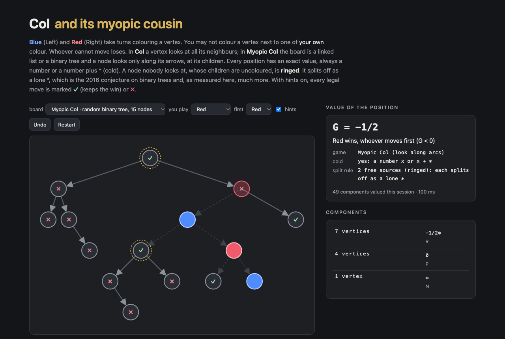

# Col and Myopic Col

Col, John Conway's map-colouring game, and Myopic Col, its directed cousin on linked lists and binary trees, in the browser with an exact combinatorial-game-theory engine. **Blue** (Left) and **Red** (Right) take turns colouring a vertex; nobody may colour a vertex next to one of **their own** colour. **Whoever cannot move loses.** In Col a vertex looks at all its neighbours. In Myopic Col (Bovee–Burke–Tennenhouse, 2016) the board is a digraph and a vertex looks only along its outgoing arcs, so in a binary tree a node is blocked by its children but not by its parent.

Every position gets its exact **canonical value**, the value of each component it has fallen into, and every legal move is marked **✓** (keeps the win) or **✗**. Vertices that split off as a lone `*` (nobody looks at them, and everything they look at is uncoloured) are ringed. Play against the computer, or both sides yourself.



## Run it

```sh
npm install
npm run dev        # http://localhost:5173/portfolio/col-game/
npm test           # 14 tests
npm run build      # static site in dist/
```

## How it works

- `src/col.ts`: both games on one structure. `look[u]` lists the vertices u looks at, and u may not take a colour one of them has (Col: the neighbours, both ways; Myopic Col: the out-neighbours). A coloured vertex leaves the game and removes its colour from everyone looking at it; a vertex with no colour left is gone, and an arc whose ends no longer share an allowed colour is dropped. What is left splits into (weakly connected) components and the game is their sum. `Valuer` values each component once: undirected trees are keyed by an AHU code from the centre, out-trees by a rooted code, anything else by its labelled structure. `plainOutcome` is a plain win/lose search on the board with no values, no splitting and no arc dropping, used to check the engine.
- `src/cgt.ts`: short games in canonical form (dominated options deleted, reversible ones bypassed), interned so that equal games share an id. `isCold(g)` tests whether g is a number or a number plus `*`.
- `src/main.ts`, `src/worker.ts`: the demo; the engine runs in a Web Worker and keeps its tables for the session.
- `tools/graphs.mts`: every connected graph up to n vertices (vertex extension and an exact canonical certificate; counts match OEIS A001349). `tools/trees.mts`: unordered binary trees (OEIS A001190) and rooted trees (A000081).

## Checked against the literature

The paper is M. Bovee, K. Burke and C. Tennenhouse, *Games from Basic Data Structures*, arXiv:1605.06327 (read from its TeX source). Myopic Col is introduced there.

```sh
node tools/verify.mts                 # engine vs plain search, the path Lemma and Corollary → runs/verify.json
node tools/conjecture.mts 11          # the binary-tree conjecture, every tree ≤ 11 nodes, every colouring → runs/conjecture-11.json
node tools/variants.mts 10            # the same split for roots with 1, 2 or ≥ 3 children → runs/variants-10.json
node tools/sources.mts 4              # any digraph: a vertex nobody looks at → runs/sources-4.json
node tools/sources.mts 8 200000 3     # the same on 200,000 random 8-vertex digraphs → runs/sources-8-sample.json
node tools/cold.mts col 8             # Conway's theorem, every colouring of every connected graph ≤ 8 → runs/cold-col-8.json
node tools/cold.mts myopic 4          # Myopic Col, every digraph ≤ 4 labelled vertices → runs/cold-myopic-4.json
node tools/report.mts                 # → runs/summary.json
```

| check | positions | exceptions |
|---|---:|---:|
| engine vs plain search, Col (connected graphs ≤ 6, every colouring) | 18,037 | 0 |
| engine vs plain search, Myopic Col (digraphs ≤ 4 labelled vertices, every colouring) | 333,540 | 0 |
| Lemma: list of n uncoloured nodes = n·\*, followed by blue = (n−1)·\* − 1, by red = (n−1)·\* + 1 | n ≤ 400 | 0 |
| Corollary a·\* + b − c, every colouring of lists ≤ 13 nodes | 2,391,483 | 0 |
| Corollary, every colouring of forests of 2–4 lists, ≤ 9 nodes | 2,336,130 | 0 |
| **Conjecture** G(T) = \* + G(T₁) + G(T₂), binary trees ≤ 11 nodes (of 31,469,089 positions) | 1,883,902 | 0 |
| the same split, root with one child (rooted trees ≤ 10) | 2,168,662 | 0 |
| the same split, root with three or more children (rooted trees ≤ 10) | 112,615 | 0 |
| any digraph ≤ 4 vertices: an uncoloured vertex nobody looks at, all it looks at uncoloured | 23,430 | 0 |
| … the same on 200,000 random 8-vertex digraphs | 67,481 | 0 |
| … but a vertex somebody does look at (≤ 4 vertices) | 52,686 | 34,960 |
| Col is cold (Conway): every colouring of every connected graph ≤ 8 vertices | 6,172,661 | 0 |
| Myopic Col is cold: every colouring of every digraph ≤ 4 vertices, and every binary-tree position above | 333,540 + 31,469,089 | 0 |

What the numbers say:

- **The paper's results on lists hold as printed**, including the corollary's count rule.
- **The conjecture holds on every binary tree up to 11 nodes**, and it is a special case of something wider that also holds everywhere it was measured: a vertex that nobody looks at, and that sees only uncoloured vertices, is an independent `*`. On a list this is the Lemma (the head peels off as `*`), on a tree it is the conjecture, with any number of children, and it holds on arbitrary digraphs with shared children and cycles elsewhere. The hypothesis that nobody looks at the vertex is needed: the 3-vertex digraph 0 → 1, 0 → 2, 1 → 0 is 0, not `*` (the "watched root" preset). Not proved here.
- **Every Myopic Col position measured is cold** (a number or a number plus `*`), as Conway proved for Col. The paper only remarks that values such as 1/2 and −3/4 occur. The smallest are a 3-node tree (−1/2) and a 5-node tree (−3/4); binary trees up to 11 nodes take 66 distinct values and **no denominator beyond 4**, while Col on 8-vertex graphs already reaches ±3/16.
- On an uncoloured board both games are symmetric, so G = −G and a cold value can only be 0 or `*`. Of the 11,117 connected graphs on 8 vertices, 7,360 are 0 (the second player wins) and 3,757 are `*`.

## License

MIT © 2026 SEN LLC
